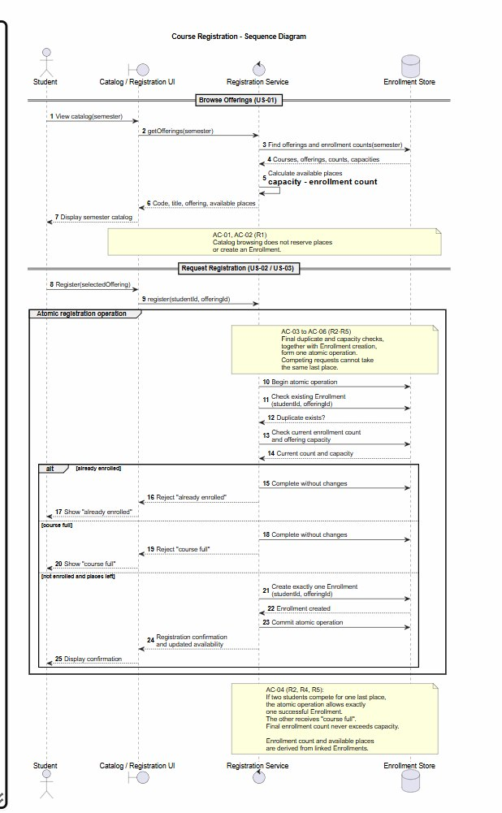
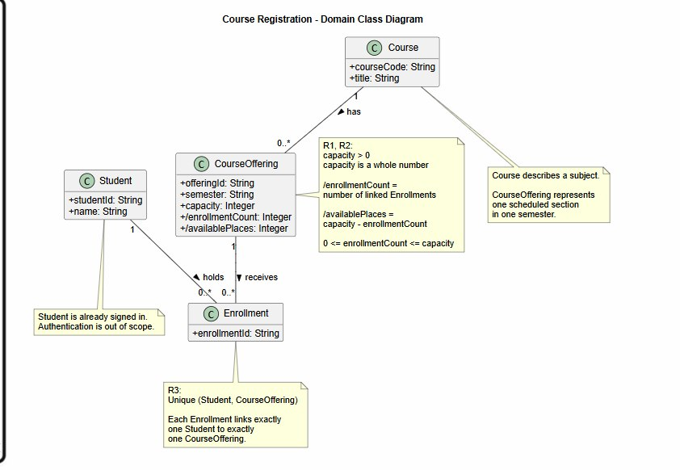
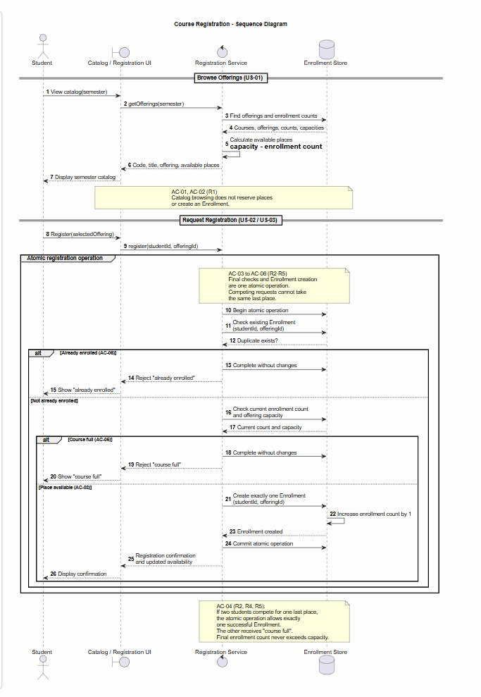
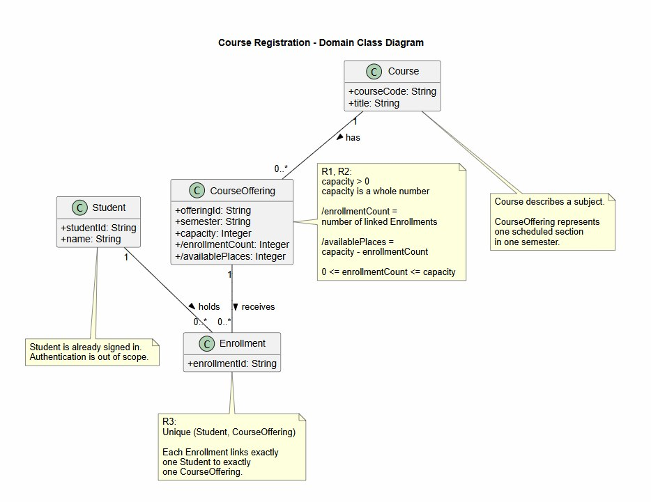

# SIS #02 — AI-Assisted UML Modeling: University Course Registration

<!--
  This is the only file you write your report in. README.md tells you what goes where.

  Rules the checker relies on:
  - Do not delete, rename or renumber the ## headings, the ### headings, or the **Label:** words.
  - Replace every "(write here)" and "(paste here)". None may be left when you submit.
  - Comments like this one are ignored by the checker and the word counter. Delete them or leave them.
-->

## 1. Scope and assumptions

**Scope:** The system allows a signed-in student to browse course offerings for one semester and request registration for one specific offering. It rechecks duplicate enrollment and current capacity when registering, creates exactly one Enrollment on success, and rejects full or duplicate requests without changing the enrollment count. Payments, prerequisites, timetable clashes, waiting lists, and cancellation are out of scope.

**Assumptions:**

1. Available places for an offering equal its capacity minus its current enrollments, and capacity is a positive whole number.
2. The student is already signed in and identified, and the selected offering already exists, so authentication and offering setup are not modeled.
3. Each registration request concerns exactly one offering, and the duplicate check, capacity check, and Enrollment creation are performed as one atomic operation.
4. A catalog view only displays availability and does not reserve a place; availability is checked again when registration is requested.

## 2. User stories and acceptance criteria

### US-01 — Browse offerings

**US-01:** As a student, I want to view course offerings for one semester, including course information and available places, so that I can choose an offering to register for.

- **AC-01** (R1): Given student Alex is viewing the electronic course catalog for the Fall 2026 semester, When Alex opens the catalog, Then the system displays the course code, course title, scheduled offering and available places for that semester.
- **AC-02** (R1): Given offering CS101-A has a capacity of 2 and currently has 1 enrollment, When Alex views the offering in the catalog without requesting registration, Then the system displays 1 available place, creates no Enrollment, and leaves the enrollment count unchanged.

### US-02 — Register for an offering

**US-02:** As a student, I want to register for a selected course offering, so that I can receive confirmation when my registration succeeds.

- **AC-03** (R2, R3, R4): Given offering CS101-A has a capacity of 3, currently has 2 enrollments, and student Alex is not enrolled in it, When Alex requests registration for CS101-A, Then the system checks for duplicate enrollment and current availability, creates exactly one Enrollment linking Alex to CS101-A, increases the enrollment count to 3, updates available places to 0, and returns a confirmation.
- **AC-04** (R2, R4, R5): Given offering CS101-A has a capacity of 2, currently has 1 enrollment, and neither Alex nor Sam is enrolled in it, When Alex and Sam submit competing registration requests for CS101-A, Then the requests are handled atomically so exactly one request succeeds and creates one Enrollment and receives confirmation, while the other is rejected with "course full", creates no Enrollment, and the final enrollment count is 2.

### US-03 — Receive a clear rejection

**US-03:** As a student, I want to receive a clear explanation when my registration is rejected because an offering is full or I am already enrolled, so that I understand why registration did not succeed.

- **AC-05** (R2, R5): Given offering MATH201-B has a capacity of 2 and currently has 2 enrollments, and student Sam is not enrolled in it, When Sam requests registration for MATH201-B, Then the system rechecks current availability, rejects the request with "course full", creates no Enrollment, and leaves the enrollment count at 2.
- **AC-06** (R3, R5): Given student Alex already has one Enrollment in offering CS101-A, When Alex requests registration for CS101-A again, Then the system rejects the request with "already enrolled", creates no additional Enrollment, and leaves the enrollment count unchanged.

## 3. Sequence diagram



**Participants:** `Student` is the student who browses the catalog and requests registration. `Catalog / Registration UI` represents the interface used by the student. `Registration Service` coordinates catalog retrieval and registration logic. `Enrollment Store` provides offering and enrollment data and stores the new Enrollment after a successful registration.

**Atomic operation:** After `register(studentId, offeringId)`, the Registration Service begins the atomic operation, checks whether an Enrollment already exists, checks the current enrollment count and offering capacity, and, on the successful branch, creates exactly one Enrollment. These final checks and the creation belong to the same atomic registration operation so competing requests cannot take the same last place. The earlier catalog view only reads and displays availability, so it does not reserve a place.

**Where the Enrollment is created:** The Enrollment is created by the message `Create exactly one Enrollment (studentId, offeringId)` from `Registration Service` to `Enrollment Store` in the `not enrolled and places left` branch. It produces an instance of the `Enrollment` class shown in the class diagram.

**Technical lifelines:** `Catalog / Registration UI`, `Registration Service`, and `Enrollment Store` are technical lifelines and are not domain classes in the class diagram. This is appropriate because the sequence diagram shows how the system performs the interaction, while the class diagram models the domain concepts and their relationships.

## 4. Class diagram



| Association | Read left to right | Read right to left |
| --- | --- | --- |
| `Course "1" -- "0..*" CourseOffering` | One Course can have zero or many CourseOfferings. | Each CourseOffering belongs to exactly one Course. |
| `Student "1" -- "0..*" Enrollment` | One Student can hold zero or many Enrollments. | Each Enrollment belongs to exactly one Student. |
| `CourseOffering "1" -- "0..*" Enrollment` | One CourseOffering can receive zero or many Enrollments. | Each Enrollment belongs to exactly one CourseOffering. |

**How an Enrollment links a student to an offering:** Each Enrollment is associated with exactly one Student and exactly one CourseOffering. Together, these two associations represent the registration of one student in one specific offering.

**Capacity constraint:** `capacity` must be a positive whole number, and `0 <= enrollmentCount <= capacity`. The derived `availablePlaces` value equals `capacity - enrollmentCount`. Multiplicity alone cannot express this constraint because `0..*` does not set an upper limit that depends on the value of the offering's `capacity` attribute.

**Uniqueness constraint:** `Unique(Student, CourseOffering)` means that the same student may have at most one Enrollment for the same offering. Multiplicity alone cannot express this because it allows a Student to have many Enrollments and a CourseOffering to have many Enrollments, but it cannot prevent two of those Enrollment objects from connecting the same Student and CourseOffering pair.

## 5. Traceability

<!-- Every rule, including the catalog fields and availability (R1). Column 1: the rule and
     the criteria that cover it, e.g. "R2 + AC-03, AC-04". Column 2: the message, guard,
     class or constraint that shows the rule in YOUR diagrams. Column 3: the T-ID that
     exercises it, or the extra check you did instead (R1 has no T case). -->

| Rule and criterion | Model evidence | Validation case |
| --- | --- | --- |
| R1 + AC-01, AC-02 | Sequence: `View catalog(semester)` → `getOfferings(semester)` → `Find offerings and enrollment counts(semester)` → `Display semester catalog`. The response includes course code, title, offering and available places. The catalog note states that browsing creates no Enrollment. Class: `Course` has `courseCode` and `title`; `CourseOffering` has `offeringId`, `semester`, and derived `availablePlaces`. | Extra check: AC-01 and AC-02 verify the catalog output and confirm that viewing availability creates no Enrollment or reservation. |
| R2 + AC-03, AC-04, AC-05 | Sequence: after `register(studentId, offeringId)`, the atomic operation performs `Check current enrollment count and offering capacity` before creation. The `course full` branch rejects, while the success branch creates one Enrollment. Class: `0 <= enrollmentCount <= capacity` and `availablePlaces = capacity - enrollmentCount`. | T1, T2, T3 |
| R3 + AC-03, AC-06 | Sequence: `Check existing Enrollment(studentId, offeringId)` occurs before creation, and `alt already enrolled` rejects without creating another Enrollment. Class: `Unique(Student, CourseOffering)` states the uniqueness constraint. | T4 |
| R4 + AC-03, AC-04 | Sequence: only `else not enrolled and places left` sends `Create exactly one Enrollment(studentId, offeringId)`, followed by `Enrollment created`, commit, updated availability and registration confirmation. Class: each Enrollment links exactly one Student and one CourseOffering. | T1, T2 |
| R5 + AC-04, AC-05, AC-06 | Sequence: `alt already enrolled` returns `"already enrolled"` and `else course full` returns `"course full"`; both use `Complete without changes` and contain no Enrollment creation or success confirmation. | T3, T4 |

## 6. Walkthroughs

<!-- Walk each case through YOUR final sequence diagram, message by message. Column 2: the
     actual steps and the state change (count before → after). Column 3 starts with Pass or
     Fail, then the location: the message, guard or note where you saw it. A Fail you
     report honestly is a finding, not a penalty. -->

| Case | Observed path and state change | Judgment and evidence |
| --- | --- | --- |
| T1. Available | Capacity is 2 and enrolled count is 0. The student sends `Register(selectedOffering)`, the UI sends `register(studentId, offeringId)`, and the atomic operation starts. The service checks for an existing Enrollment, checks the current enrollment count and capacity, then follows `else not enrolled and places left`. It sends `Create exactly one Enrollment(studentId, offeringId)`, commits the atomic operation and returns confirmation. The new Enrollment changes the derived count from 0 → 1 and available places from 2 → 1. | **Pass** — the success path is visible at `else not enrolled and places left`, followed by `Create exactly one Enrollment`, `Commit atomic operation`, and `Registration confirmation`. |
| T2. Last place | Capacity is 2 and enrolled count is 1. After `register(studentId, offeringId)`, the atomic operation checks duplicate enrollment and current capacity. Because the student is not enrolled and one place remains, the sequence follows `else not enrolled and places left`, creates exactly one Enrollment, commits and confirms success. The derived enrollment count changes from 1 → 2 and available places from 1 → 0. | **Pass** — the capacity check occurs before creation, and the success branch creates exactly one Enrollment. The atomic note states that the final count cannot exceed capacity. |
| T3. Full | The earlier catalog view showed a place, but it did not reserve it. At registration time the current state is capacity 2 and enrolled count 2. The service performs the final checks inside the atomic operation, reads the current count and capacity, and follows `else course full`. It sends `Complete without changes`, returns `Reject "course full"` and shows the rejection to the student. No Enrollment is created, so the count remains 2 → 2. | **Pass** — the evidence is the fresh `Check current enrollment count and offering capacity` message, the `else course full` branch, and `Complete without changes`; the catalog note also states that browsing does not reserve a place. |
| T4. Duplicate | Capacity is 2 and enrolled count is 1, and that Enrollment already belongs to the requesting student for this offering. The service receives `register(studentId, offeringId)`, checks the existing Enrollment and receives that a duplicate exists. The current capacity is also read, then the sequence follows `alt already enrolled`. It completes without changes and returns `Reject "already enrolled"`. No additional Enrollment is created, so the count remains 1 → 1. | **Pass** — the duplicate is detected by `Check existing Enrollment(studentId, offeringId)` and handled by `alt already enrolled`, which contains no creation or confirmation message and ends with `Complete without changes`. |

## 7. Review decisions

<!-- At least three substantive decisions about Prompt C's critique or your own inspection.
     Decision: accepted / rejected / modified — and what you did. Reason: why, in a full
     sentence. Rule: R1–R5. Do not invent an error to fill the table; a justified rejection
     of advice counts. -->

| Element | Decision | Reason / evidence | Rule(s) |
|---|---|---|---|
| Sequence diagram — atomic registration note and AI suggestion to add database row locking | Reject | The assignment explicitly says that a note describing the atomic operation is enough, so adding database locking would introduce an unnecessary implementation detail. | R2, R4, R5 |
| Sequence diagram — `Store -> Store : Increase enrollment count by 1` while `/enrollmentCount` is derived in the class diagram | Accept | The class diagram defines enrollment count from linked Enrollment objects, so creating one Enrollment should be the state change and the count should remain derived. | R2, R4 |
| Sequence diagram — current nested `alt` branches and AI suggestion to use square-bracket Boolean guards | Modify | The required final sequence uses three alternatives without square brackets: `alt already enrolled`, `else course full`, and `else not enrolled and places left`. | R2, R3, R5 |
| Class diagram — AI suggestion to change `capacity > 0` to `capacity >= 0` | Reject | The scenario explicitly states that an offering capacity is a positive whole number, therefore zero capacity is outside the stated assumptions. | R2 |
| Sequence diagram — `Find offerings and enrollment counts` store message | Accept | Adding the semester argument makes the catalog retrieval more directly traceable to R1 without adding any new feature or university policy. | R1 |

## 8. Modeling explanation

The final model uses two UML diagrams because they show different parts of the same course registration system. The class diagram describes the static domain structure. It contains Student, Course, CourseOffering, and Enrollment. CourseOffering stores the semester and capacity, while enrollmentCount and availablePlaces are derived from the linked Enrollment objects. The multiplicities show that one Course can have many CourseOfferings, one Student can have many Enrollments, and one CourseOffering can have many Enrollments. The uniqueness note is necessary because multiplicity alone cannot prevent the same Student and CourseOffering pair from being linked twice.

The sequence diagram explains the behavior over time. It first shows catalog browsing, which only reads the current data and does not reserve a place. During registration, the system starts one atomic operation, checks for an existing Enrollment, rechecks current capacity, and then follows one of three branches: already enrolled, course full, or not enrolled and places left. Only the successful branch creates an Enrollment and returns confirmation. This makes the connection between the behavioral model and the domain model clear: the successful sequence creates the Enrollment object shown in the class diagram.

An activity diagram could also help because it would show the decision flow more compactly. It could make the three outcomes and the order of duplicate and capacity checks easier to scan, but it would not show the interaction between Student, UI, Registration Service, and Enrollment Store as clearly as the sequence diagram.

## 9. Reflection

AI was most useful for producing a first draft of the user stories, acceptance criteria, and UML diagrams quickly. It also helped identify inconsistencies that were easy to miss when reading the diagrams visually. However, I did not accept every suggestion. One important decision I made was to reject the recommendation to add database row locking to the sequence diagram. The assignment only requires the final checks and Enrollment creation to be modeled as one atomic operation, and a note is enough, so adding a specific locking mechanism would make the model more implementation-specific than necessary.

I accepted the criticism about `enrollmentCount` because the class diagram marks it as a derived value. Therefore, creating an Enrollment should be the real state change instead of manually increasing a separate counter.

A limitation of the AI critique was that it sometimes suggested technically reasonable ideas that did not match the exact assignment rules, such as square-bracket guards and extra concurrency details. This showed me that AI feedback still has to be checked against the specification before it is applied.

## 10. Appendix A — Before AI

**Scope:** A signed-in student browses the course catalog for one semester, chooses one specific offering and requests registration; the system rechecks capacity and duplicate enrollment, then either creates exactly one Enrollment or rejects the request without changing the enrollment count.

**Initial assumptions:**
1. Available places for an offering equal its capacity minus its current enrollments,
   and capacity is a positive whole number.
2. The student is already signed in and identified, and the chosen offering already
   exists, so authentication and offering setup are not modeled.
3. Each registration request concerns exactly one offering, and the final capacity check
   together with the creation of the Enrollment is a single atomic operation.
4. A catalog view only displays availability and does not reserve a place; availability
   is checked again at the moment of registration.
## 11. Appendix B — AI exchanges

<!-- Complete prompts and complete responses, as text — never screenshots. Paste each inside
     the ~~~~ block that follows its label: AI responses contain ``` PlantUML blocks, and
     ~~~~ keeps them from breaking this file. Prompts B and C: the prompt text first, then
     the material it refers to ("below", "these two") pasted under it, in the same block.
     You may add B5, B6 … after B4 if you ran more. -->

### B1 — Requirements (Prompt A)

- **Tool:** ChatGPT
- **Model:** GPT-5.6 Sol
- **Date:** 2026-10-16
- **Purpose:** draft 3 user stories and 6 acceptance criteria

**Prompt:**

~~~~text
Act as a requirements analyst. Use only this course registration scenario and rules R1–R5: A student browses an electronic course catalog, chooses a course offering and requests registration. Each offering has a limited number of places. A Course describes a subject. A CourseOffering is one scheduled section in one semester. Registration always targets a specific offering. Assume that the student is signed in, the selected offering exists, and its capacity is a positive whole number.

R1. Catalog: Show the course code, title, offering and available places for one semester.
R2. Capacity: Recheck current availability when registering. Enrollment must never exceed the offering's capacity.
R3. Duplicates: A student may have at most one enrollment in the same offering. Reject a repeat request.
R4. Success: Create exactly one Enrollment linking the student and offering, update availability and return a confirmation.
R5. Rejection: Explain "course full" or "already enrolled". Create no enrollment and leave the enrollment count unchanged.

A catalog view does not reserve a place. Model the final checks and enrollment creation as one atomic operation, so competing requests cannot take the same last place. A note describing it is enough. Out of scope: payments, prerequisites, timetable clashes, waiting lists, cancellation. Use fictional students and courses. Treat any extra AI suggestion as a proposal you accept or reject explicitly. My initial assumptions are:

1. Available places for an offering equal its capacity minus its current enrollments, and capacity is a positive whole number.
2. The student is already signed in and identified, and the chosen offering already exists, so authentication and offering setup are not modeled.
3. Each registration request concerns exactly one offering, and the final capacity check together with the creation of the Enrollment is a single atomic operation.
4. A catalog view only displays availability and does not reserve a place; availability is checked again at the moment of registration.

Draft 3 user stories and 2 Given / When / Then acceptance criteria for each. Use IDs US-01 to US-03 and AC-01 to AC-06. Map each criterion to rule IDs.
Cover normal and rejection behavior. List uncertainty separately. Do not add excluded features or invent university policies.
~~~~

**Response:**

~~~~text
# Course Registration System — User Stories and Acceptance Criteria

## 1. Confirmed assumptions

The four initial assumptions are accepted because they are consistent with the scenario and rules R1–R5.

| ID | Assumption | Status |
|---|---|---|
| A1 | Available places = offering capacity − current enrollments. Capacity is a positive whole number. | Accepted |
| A2 | Student is signed in and identified; the selected offering exists. | Accepted |
| A3 | Each registration request targets exactly one offering. Final checks and enrollment creation are atomic. | Accepted |
| A4 | Browsing the catalog does not reserve a place. Availability is rechecked at registration. | Accepted |

## 2. User stories and acceptance criteria

### US-01 — Browse Course Catalog

**User story:** As a student, I want to view course offerings for a semester, including course information and available places, so that I can choose an offering to register for.

#### AC-01 — Display semester catalog

**Mapped rule:** R1

- **Given** student Alex is viewing the electronic course catalog for the Fall 2026 semester
- **When** Alex opens the catalog
- **Then** the system displays the course code, course title, scheduled offering and available places for that semester.

#### AC-02 — Viewing does not reserve a place

**Mapped rules:** R1, R2

- **Given** offering CS101-A has a capacity of 2 and currently has 1 enrollment
- **When** Alex views the offering in the catalog without requesting registration
- **Then** the system displays 1 available place, creates no Enrollment, and leaves the enrollment count unchanged.

### US-02 — Register for an Available Offering

**User story:** As a student, I want to register for a selected course offering so that I can receive confirmation of my enrollment when a place is available.

#### AC-03 — Successful registration

**Mapped rules:** R2, R3, R4

- **Given** offering CS101-A has a capacity of 3, currently has 2 enrollments, and student Alex is not enrolled in it
- **When** Alex requests registration for CS101-A
- **Then** the system rechecks availability, creates exactly one Enrollment linking Alex to CS101-A, increases the enrollment count to 3, updates available places to 0, and returns a confirmation.

#### AC-04 — Competing requests for the last place

**Mapped rules:** R2, R4, R5

- **Given** offering CS101-A has a capacity of 2, currently has 1 enrollment, and neither Alex nor Sam is enrolled in it
- **When** Alex and Sam submit competing registration requests for CS101-A
- **Then** exactly one request succeeds and creates one Enrollment, while the other is rejected with "course full" and creates no Enrollment. The final enrollment count is 2 and never exceeds capacity.

### US-03 — Reject Invalid Registration Requests

**User story:** As a student, I want to receive a clear explanation when my registration is rejected because an offering is full or I am already enrolled, so that I understand why registration did not succeed.

#### AC-05 — Reject registration when offering is full

**Mapped rules:** R2, R5

- **Given** offering MATH201-B has a capacity of 2 and currently has 2 enrollments, and student Sam is not enrolled in it
- **When** Sam requests registration for MATH201-B
- **Then** the system rejects the request with "course full", creates no Enrollment, and leaves the enrollment count at 2.

#### AC-06 — Reject duplicate enrollment

**Mapped rules:** R3, R5

- **Given** student Alex already has one Enrollment in offering CS101-A
- **When** Alex requests registration for CS101-A again
- **Then** the system rejects the request with "already enrolled", creates no additional Enrollment, and leaves the enrollment count unchanged.

## 3. Rule coverage matrix

| Rule | Description | Acceptance criteria |
|---|---|---|
| R1 | Catalog information | AC-01, AC-02 |
| R2 | Capacity and current availability | AC-02, AC-03, AC-04, AC-05 |
| R3 | No duplicate enrollments | AC-03, AC-06 |
| R4 | Successful registration | AC-03, AC-04 |
| R5 | Rejection without changing enrollments | AC-04, AC-05, AC-06 |

All five rules are covered by the six acceptance criteria.

## 4. Atomic operation note

The final availability check, duplicate-enrollment check and Enrollment creation must execute as one atomic operation.

For example, if CS101-A has one remaining place and Alex and Sam request registration simultaneously, only one request may succeed. The other must receive "course full". The final enrollment count must never exceed capacity.

The system must also ensure that competing repeat requests from the same student cannot create duplicate enrollments.

No specific database or locking technology is assumed.

## 5. Uncertainty and unresolved questions

| ID | Uncertainty | Treatment |
|---|---|---|
| U-01 | If an offering is full and the student is also already enrolled, which rejection message takes priority? | Unspecified. Do not assume precedence. |
| U-02 | What exact information must appear in a successful confirmation? | Unspecified beyond confirming successful registration. |
| U-03 | How should scheduled offerings be formatted or identified in the catalog? | Unspecified. The offering must be identifiable, but no display format is assumed. |

These uncertainties do not prevent drafting the six criteria.

## 6. Additional AI proposals and decisions

| Proposal | Decision | Reason |
|---|---|---|
| Add payment processing | Rejected | Explicitly out of scope |
| Add prerequisite checking | Rejected | Explicitly out of scope |
| Add timetable-clash validation | Rejected | Explicitly out of scope |
| Add waiting lists or cancellation | Rejected | Explicitly out of scope |
| Specify database transactions or locking implementation | Rejected | Atomic behavior is required, but implementation technology is not specified |
| Clarify rejection-message priority when both rejection conditions apply | Accepted as an open question, not a new requirement | Needed to eliminate ambiguity without inventing policy |

Final result: 3 user stories (US-01–US-03), 6 acceptance criteria (AC-01–AC-06), complete R1–R5 coverage, four accepted initial assumptions, and three separately identified uncertainties.
~~~~

### B2 — UML drafts (Prompt B)

- **Tool:** ChatGPT
- **Model:** GPT-5.6 Sol
- **Date:** 2026-10-16
- **Purpose:** draft the sequence and class diagrams

**Prompt:**

~~~~text
Using my approved scenario, R1–R5, stories and criteria below, return separate PlantUML code blocks for a sequence diagram and a domain class diagram.
Sequence: include catalog browsing and guarded success, full-course and duplicate outcomes. Model final checks and creation as one atomic operation.
Class: show domain concepts, useful attributes and multiplicities. State the capacity and uniqueness constraints. Explain assumptions and any technical lifelines.

### US-01 — Browse offerings

US-01: As a student, I want to view course offerings for one semester, including course information and available places, so that I can choose an offering to register for.

AC-01 (R1): Given student Alex is viewing the electronic course catalog for the Fall 2026 semester, When Alex opens the catalog, Then the system displays the course code, course title, scheduled offering and available places for that semester.

AC-02 (R1): Given offering CS101-A has a capacity of 2 and currently has 1 enrollment, When Alex views the offering in the catalog without requesting registration, Then the system displays 1 available place, creates no Enrollment, and leaves the enrollment count unchanged.

### US-02 — Register for an offering

US-02: As a student, I want to register for a selected course offering, so that I can receive confirmation when my registration succeeds.

AC-03 (R2, R3, R4): Given offering CS101-A has a capacity of 3, currently has 2 enrollments, and student Alex is not enrolled in it, When Alex requests registration for CS101-A, Then the system checks for duplicate enrollment and current availability, creates exactly one Enrollment linking Alex to CS101-A, increases the enrollment count to 3, updates available places to 0, and returns a confirmation.

AC-04 (R2, R4, R5): Given offering CS101-A has a capacity of 2, currently has 1 enrollment, and neither Alex nor Sam is enrolled in it, When Alex and Sam submit competing registration requests for CS101-A, Then the requests are handled atomically so exactly one request succeeds and creates one Enrollment and receives confirmation, while the other is rejected with "course full", creates no Enrollment, and the final enrollment count is 2.

### US-03 — Receive a clear rejection

US-03: As a student, I want to receive a clear explanation when my registration is rejected because an offering is full or I am already enrolled, so that I understand why registration did not succeed.

AC-05 (R2, R5): Given offering MATH201-B has a capacity of 2 and currently has 2 enrollments, and student Sam is not enrolled in it, When Sam requests registration for MATH201-B, Then the system rechecks current availability, rejects the request with "course full", creates no Enrollment, and leaves the enrollment count at 2.

AC-06 (R3, R5): Given student Alex already has one Enrollment in offering CS101-A, When Alex requests registration for CS101-A again, Then the system rejects the request with "already enrolled", creates no additional Enrollment, and leaves the enrollment count unchanged.
~~~~

**Response:**

~~~~text

@startuml
title Course Registration - Sequence Diagram

autonumber

actor Student
boundary "Catalog / Registration UI" as UI
control "Registration Service" as Service
database "Enrollment Store" as Store

== Browse Offerings (US-01) ==

Student -> UI : View catalog(semester)
UI -> Service : getOfferings(semester)
Service -> Store : Find offerings and enrollment counts
Store --> Service : Courses, offerings, counts, capacities
Service -> Service : Calculate available places\n= capacity - enrollment count
Service --> UI : Code, title, offering, available places
UI --> Student : Display semester catalog

note over UI, Store
AC-01, AC-02 (R1)
Catalog browsing does not reserve places
or create an Enrollment.
end note

== Request Registration (US-02 / US-03) ==

Student -> UI : Register(selectedOffering)
UI -> Service : register(studentId, offeringId)

group Atomic registration operation
    note over Service, Store
    AC-03 to AC-06 (R2-R5)
    Final checks and Enrollment creation
    are one atomic operation.
    Competing requests cannot take
    the same last place.
    end note

    Service -> Store : Begin atomic operation
    Service -> Store : Check existing Enrollment\n(studentId, offeringId)
    Store --> Service : Duplicate exists?

    alt Already enrolled (AC-06)
        Service -> Store : Complete without changes
        Service --> UI : Reject "already enrolled"
        UI --> Student : Show "already enrolled"

    else Not already enrolled
        Service -> Store : Check current enrollment count\nand offering capacity
        Store --> Service : Current count and capacity

        alt Course full (AC-05)
            Service -> Store : Complete without changes
            Service --> UI : Reject "course full"
            UI --> Student : Show "course full"

        else Place available (AC-03)
            Service -> Store : Create exactly one Enrollment\n(studentId, offeringId)
            Store -> Store : Increase enrollment count by 1
            Store --> Service : Enrollment created
            Service -> Store : Commit atomic operation
            Service --> UI : Registration confirmation\nand updated availability
            UI --> Student : Display confirmation
        end
    end
end

note over Service, Store
AC-04 (R2, R4, R5):
If two students compete for one last place,
the atomic operation allows exactly
one successful Enrollment.
The other receives "course full".
Final enrollment count never exceeds capacity.
end note

@enduml

@startuml
title Course Registration - Domain Class Diagram

skinparam classAttributeIconSize 0
hide empty methods

class Student {
  +studentId: String
  +name: String
}

class Course {
  +courseCode: String
  +title: String
}

class CourseOffering {
  +offeringId: String
  +semester: String
  +capacity: Integer
  +/enrollmentCount: Integer
  +/availablePlaces: Integer
}

class Enrollment {
  +enrollmentId: String
}

Course "1" -- "0..*" CourseOffering : has >
Student "1" -- "0..*" Enrollment : holds >
CourseOffering "1" -- "0..*" Enrollment : receives >

note right of CourseOffering
R1, R2:
capacity > 0
capacity is a whole number

/enrollmentCount =
number of linked Enrollments

/availablePlaces =
capacity - enrollmentCount

0 <= enrollmentCount <= capacity
end note

note bottom of Enrollment
R3:
Unique (Student, CourseOffering)

Each Enrollment links exactly
one Student to exactly
one CourseOffering.
end note

note bottom of Student
Student is already signed in.
Authentication is out of scope.
end note

note bottom of Course
Course describes a subject.

CourseOffering represents
one scheduled section
in one semester.
end note

@enduml

~~~~

### B3 — Model critique (Prompt C)

- **Tool:** ChatGPT
- **Model:** GPT-5.6 Sol
- **Date:** 2026-10-16
- **Purpose:** critique the original sequence and class diagrams against R1–R5 and AC-01–AC-06

**Prompt:**

~~~~text
Review these two UML models against R1–R5 and my acceptance criteria. Check message order, guards, state changes, multiplicities and naming.
Inspect the four validation cases: available places, exactly one place, full course after a stale catalog view, and duplicate registration.
For each issue, cite the affected rule and model element. Explain the impact and propose a focused correction. Separate genuine defects from optional design choices.

Original sequence diagram:

@startuml
title Course Registration - Sequence Diagram

autonumber

actor Student
boundary "Catalog / Registration UI" as UI
control "Registration Service" as Service
database "Enrollment Store" as Store

== Browse Offerings (US-01) ==

Student -> UI : View catalog(semester)
UI -> Service : getOfferings(semester)
Service -> Store : Find offerings and enrollment counts
Store --> Service : Courses, offerings, counts, capacities
Service -> Service : Calculate available places\n= capacity - enrollment count
Service --> UI : Code, title, offering, available places
UI --> Student : Display semester catalog

note over UI, Store
AC-01, AC-02 (R1)
Catalog browsing does not reserve places
or create an Enrollment.
end note

== Request Registration (US-02 / US-03) ==

Student -> UI : Register(selectedOffering)
UI -> Service : register(studentId, offeringId)

group Atomic registration operation
    note over Service, Store
    AC-03 to AC-06 (R2-R5)
    Final checks and Enrollment creation
    are one atomic operation.
    Competing requests cannot take
    the same last place.
    end note

    Service -> Store : Begin atomic operation
    Service -> Store : Check existing Enrollment\n(studentId, offeringId)
    Store --> Service : Duplicate exists?

    alt Already enrolled (AC-06)
        Service -> Store : Complete without changes
        Service --> UI : Reject "already enrolled"
        UI --> Student : Show "already enrolled"

    else Not already enrolled
        Service -> Store : Check current enrollment count\nand offering capacity
        Store --> Service : Current count and capacity

        alt Course full (AC-05)
            Service -> Store : Complete without changes
            Service --> UI : Reject "course full"
            UI --> Student : Show "course full"

        else Place available (AC-03)
            Service -> Store : Create exactly one Enrollment\n(studentId, offeringId)
            Store -> Store : Increase enrollment count by 1
            Store --> Service : Enrollment created
            Service -> Store : Commit atomic operation
            Service --> UI : Registration confirmation\nand updated availability
            UI --> Student : Display confirmation
        end
    end
end

note over Service, Store
AC-04 (R2, R4, R5):
If two students compete for one last place,
the atomic operation allows exactly
one successful Enrollment.
The other receives "course full".
Final enrollment count never exceeds capacity.
end note

@enduml

Original class diagram:

@startuml
title Course Registration - Domain Class Diagram

skinparam classAttributeIconSize 0
hide empty methods

class Student {
  +studentId: String
  +name: String
}

class Course {
  +courseCode: String
  +title: String
}

class CourseOffering {
  +offeringId: String
  +semester: String
  +capacity: Integer
  +/enrollmentCount: Integer
  +/availablePlaces: Integer
}

class Enrollment {
  +enrollmentId: String
}

Course "1" -- "0..*" CourseOffering : has >
Student "1" -- "0..*" Enrollment : holds >
CourseOffering "1" -- "0..*" Enrollment : receives >

note right of CourseOffering
R1, R2:
capacity > 0
capacity is a whole number

/enrollmentCount =
number of linked Enrollments

/availablePlaces =
capacity - enrollmentCount

0 <= enrollmentCount <= capacity
end note

note bottom of Enrollment
R3:
Unique (Student, CourseOffering)

Each Enrollment links exactly
one Student to exactly
one CourseOffering.
end note

note bottom of Student
Student is already signed in.
Authentication is out of scope.
end note

note bottom of Course
Course describes a subject.

CourseOffering represents
one scheduled section
in one semester.
end note

@enduml

Acceptance criteria:

AC-01 (R1): Given student Alex is viewing the electronic course catalog for the Fall 2026 semester, When Alex opens the catalog, Then the system displays the course code, course title, scheduled offering and available places for that semester.

AC-02 (R1): Given offering CS101-A has a capacity of 2 and currently has 1 enrollment, When Alex views the offering in the catalog without requesting registration, Then the system displays 1 available place, creates no Enrollment, and leaves the enrollment count unchanged.

AC-03 (R2, R3, R4): Given offering CS101-A has a capacity of 3, currently has 2 enrollments, and student Alex is not enrolled in it, When Alex requests registration for CS101-A, Then the system checks for duplicate enrollment and current availability, creates exactly one Enrollment linking Alex to CS101-A, increases the enrollment count to 3, updates available places to 0, and returns a confirmation.

AC-04 (R2, R4, R5): Given offering CS101-A has a capacity of 2, currently has 1 enrollment, and neither Alex nor Sam is enrolled in it, When Alex and Sam submit competing registration requests for CS101-A, Then the requests are handled atomically so exactly one request succeeds and creates one Enrollment and receives confirmation, while the other is rejected with "course full", creates no Enrollment, and the final enrollment count is 2.

AC-05 (R2, R5): Given offering MATH201-B has a capacity of 2 and currently has 2 enrollments, and student Sam is not enrolled in it, When Sam requests registration for MATH201-B, Then the system rechecks current availability, rejects the request with "course full", creates no Enrollment, and leaves the enrollment count at 2.

AC-06 (R3, R5): Given student Alex already has one Enrollment in offering CS101-A, When Alex requests registration for CS101-A again, Then the system rejects the request with "already enrolled", creates no additional Enrollment, and leaves the enrollment count unchanged.
~~~~

**Response:**

~~~~text
## Overall review

**Mostly correct — 3 modeling gaps to address**

Both UML diagrams are broadly consistent with AC-01 through AC-06. The message order is sensible, the relationships have correct multiplicities, and the successful and rejected registration paths are represented.

The main concern is AC-04 (concurrent registration): the sequence diagram states that the operation is atomic, but it does not show what guarantees that two competing requests cannot both claim the final place.

A second concern is consistency between the sequence diagram's enrollment-count update and the class diagram's derived `/enrollmentCount`.

I am using the R1–R5 mappings provided in your acceptance criteria; the full standalone wording of those requirements was not included.

---

## 1. Validation of the four cases

| Case | Expected behavior | Review |
|---|---|---|
| Available places (AC-02) | Capacity 2, count 1 → display 1 available place; no state changes | **Pass** |
| Exactly one place (AC-03) | Capacity 3, count 2 → create one Enrollment, count 3, availability 0 | **Pass** |
| Full after stale catalog view (AC-05) | A previously available place has been taken → recheck and reject without creating an Enrollment | **Pass** |
| Duplicate registration (AC-06) | Existing Enrollment → reject as `"already enrolled"`; count unchanged | **Pass** |

The concurrency case, AC-04, needs a separate qualification: the intended result is correct, but the mechanism is not sufficiently modeled.

### Message order

The sequence currently follows:

1. Begin atomic operation
2. Check duplicate
3. Check current capacity
4. Create Enrollment
5. Commit
6. Confirm success

This order is correct for AC-03 and AC-06. Duplicate checking occurs before capacity checking, meaning an already-enrolled student receives the required `"already enrolled"` message even if the offering is full.

The catalog values are only a snapshot. The sequence correctly requests current availability again during registration rather than trusting the earlier catalog display.

---

## 2. Genuine defects or modeling gaps

### Issue 1 — Atomicity and competing requests are not demonstrated

**Affected:** R2, R4, R5; AC-04

**Element:** `group Atomic registration operation`, `Service -> Store : Begin atomic operation`, and the concurrency note.

**Problem:** The diagram says competing requests cannot occupy the same final place, but an ordinary database transaction does not automatically prevent this race.

For example:

1. Alex reads count 1 of capacity 2.
2. Sam also reads count 1 of capacity 2.
3. Both independently decide that one place remains.
4. Both attempt to create an Enrollment.

Without appropriate concurrency control, the capacity invariant may be violated.

**Impact:** The diagram does not establish how the final count is guaranteed to remain at 2. AC-04 is asserted rather than demonstrated.

**Focused correction:** Specify a database-level serialization mechanism, such as locking the selected `CourseOffering` row before reading the current count and retaining that lock until the transaction completes.

A suitable replacement message is:

```text
Service -> Store : Begin transaction and lock offering(offeringId)
Store --> Service : Lock acquired
```

Then perform the duplicate check, current availability check, and Enrollment creation while holding that lock.

For AC-04, include a separate concurrency interaction showing that Alex acquires the lock, successfully registers, and commits; Sam then acquires the lock, observes a full offering, and receives `"course full"`.

This demonstrates the required outcome instead of relying on a note.

---

### Issue 2 — Enrollment count has conflicting representations

**Affected:** R2, R4; AC-03, AC-04

**Elements:**

Sequence diagram:

```text
Store -> Store : Increase enrollment count by 1
```

Class diagram:

```text
+/enrollmentCount: Integer
+/availablePlaces: Integer
```

**Problem:** In UML, the slash (`/`) indicates a derived attribute.

The class diagram defines `enrollmentCount` as the number of linked `Enrollment` objects, so inserting one Enrollment already changes the derived count.

The sequence diagram separately instructs the Store to increase the count by 1. This suggests an independently maintained counter, although that is not explicitly declared.

**Impact:** Readers cannot tell whether the count is computed from Enrollment records or stored and updated separately. If both approaches were implemented carelessly, inconsistent or double-counted values could result.

**Focused correction:** Choose one representation.

The simplest domain-model correction is to keep both attributes derived and replace the sequence message with a state description:

```text
Store -> Store : Derive updated count from Enrollments
```

The actual state-changing action remains the creation of exactly one Enrollment.

Alternatively, a stored counter is acceptable, but it should be modeled as a normal attribute and updated consistently within the same transaction as the Enrollment creation.

---

### Issue 3 — Transaction completion on rejection paths is ambiguous

**Affected:** R3, R5; AC-05, AC-06

**Element:** `Service -> Store : Complete without changes`

**Problem:** The success path explicitly commits. The duplicate and full-course paths say only `"Complete without changes."`

That communicates the intended outcome but does not explicitly indicate whether the transaction ends and its locks are released.

**Impact:** The diagram leaves transaction cleanup unspecified. An implementation must not leave an open transaction or retain locks after rejecting a request.

**Focused correction:** Replace the message in both rejection branches with:

```text
Service -> Store : End transaction without changes
```

Or explicitly use `Rollback transaction`, if that is the selected implementation approach.

A read-only transaction may also be committed normally. The important requirement is that the transaction ends, no Enrollment is inserted, and any acquired lock is released.

---

## 3. Optional design improvements — not requirement violations

| Rule and element | Observation | Suggested improvement |
|---|---|---|
| R2, R3, R5 — sequence `alt` blocks | Branch labels such as `Already enrolled` and `Place available` are understandable but not precise Boolean guards. | Use `[duplicateExists]`, `[!duplicateExists]`, `[currentCount >= capacity]` and `[currentCount < capacity]`. |
| R1, AC-01 — `CourseOffering` | `offeringId` and `semester` identify an offering, but meeting days and times are not modeled. | Add `sectionCode` or `schedule` if `"scheduled offering"` requires timetable details, not just the section identifier. |
| R3 — Enrollment uniqueness note | `Unique(Student, CourseOffering)` correctly states the domain invariant, but not its database enforcement. | Use a unique constraint on `(studentId, offeringId)` in the implementation. The domain diagram need not depict a database index. |
| R2 — capacity constraint | `capacity > 0` excludes zero-capacity offerings. | Keep it if zero capacity is forbidden; otherwise use `capacity >= 0`. The acceptance criteria do not resolve this. |
| Naming — `US-02 / US-03` | The supplied criteria do not identify what US-03 represents. | Use `US-02` alone unless US-03 is another approved story. |
| R1 — catalog query | `Find offerings and enrollment counts` does not explicitly include the semester argument at the Store level. | Rename to `Find offerings(semester) and enrollment counts` for traceability. |

These are clarification and design-quality improvements rather than proven functional defects.

---

## 4. Class diagram: multiplicity and constraint audit

All three current associations use appropriate multiplicities.

| Relationship | Meaning | Verdict |
|---|---|---|
| `Course "1" -- "0..*" CourseOffering` | Every offering belongs to one course; a course may have multiple offerings or none | **Correct** |
| `Student "1" -- "0..*" Enrollment` | Every Enrollment belongs to one student; a student may have several enrollments | **Correct** |
| `CourseOffering "1" -- "0..*" Enrollment` | Every Enrollment belongs to one offering; an offering may have many enrollments | **Correct** |

The constraints are also correctly expressed at the domain level:

\[
\begin{aligned}
\text{enrollmentCount} &= |\text{linked Enrollments}| \\
\text{availablePlaces} &= \text{capacity} - \text{enrollmentCount} \\
0 &\leq \text{enrollmentCount} \leq \text{capacity}
\end{aligned}
\]

The uniqueness invariant, `Unique(Student, CourseOffering)`, correctly prevents duplicate registration for the same offering while allowing a student to enroll in different offerings.

No additional association is necessary. In particular, a direct Student-to-CourseOffering association would be redundant because `Enrollment` already represents that relationship.

---

## 5. Final assessment by acceptance criterion

| Criterion | Final assessment |
|---|---|
| AC-01 (R1) | Satisfied, assuming offering identification provides the required scheduled-offering information |
| AC-02 (R1) | Satisfied; catalog browsing is read-only |
| AC-03 (R2, R3, R4) | Satisfied in the intended sequence; clarify the count-update representation |
| AC-04 (R2, R4, R5) | Requires explicit concurrency-control semantics and preferably a separate two-request trace |
| AC-05 (R2, R5) | Satisfied; checks current capacity and rejects without state changes |
| AC-06 (R3, R5) | Satisfied; duplicate is checked first, and no extra Enrollment is created |

---

## Conclusion

I would retain both diagrams and make focused corrections rather than redesign them.

The three priorities are to make concurrency protection explicit, reconcile the derived enrollment count with the sequence state change, and clarify transaction termination on rejected requests.

The multiplicities, duplicate-before-capacity ordering, successful registration outcome, full-course rejection, and read-only catalog behavior are correct. The extra attribute and naming suggestions are optional unless your full R1–R5 requirements impose further constraints.

With those changes, the diagrams will more clearly demonstrate the required behavior, particularly the guarantee that two competing students cannot both take the last available place.
~~~~

### B4 — Focused revision (Prompt D)

- **Tool:** ChatGPT
- **Model:** GPT-5.6 Sol
- **Date:** 2026-10-17
- **Purpose:** apply my accepted review decisions

**Prompt:**

~~~~text
Revise the UML sources using only my accepted review decisions: 1) Remove the separate "Increase enrollment count by 1" state change and keep enrollmentCount and availablePlaces derived from linked Enrollment objects. 2) Restructure the registration alternatives to use exactly three guards without square brackets: alt already enrolled, else course full, else not enrolled and places left. 3) Change the catalog Store message to include the semester argument for clearer R1 traceability. Keep justified existing elements and explain each change.
Preserve the agreed scope and rule IDs. Return both updated PlantUML blocks and a concise change log. Flag any unresolved issue.
Approved requirements:

### US-01 — Browse offerings

US-01: As a student, I want to view course offerings for one semester, including course information and available places, so that I can choose an offering to register for.

AC-01 (R1): Given student Alex is viewing the electronic course catalog for the Fall 2026 semester, When Alex opens the catalog, Then the system displays the course code, course title, scheduled offering and available places for that semester.

AC-02 (R1): Given offering CS101-A has a capacity of 2 and currently has 1 enrollment, When Alex views the offering in the catalog without requesting registration, Then the system displays 1 available place, creates no Enrollment, and leaves the enrollment count unchanged.

### US-02 — Register for an offering

US-02: As a student, I want to register for a selected course offering, so that I can receive confirmation when my registration succeeds.

AC-03 (R2, R3, R4): Given offering CS101-A has a capacity of 3, currently has 2 enrollments, and student Alex is not enrolled in it, When Alex requests registration for CS101-A, Then the system checks for duplicate enrollment and current availability, creates exactly one Enrollment linking Alex to CS101-A, increases the enrollment count to 3, updates available places to 0, and returns a confirmation.

AC-04 (R2, R4, R5): Given offering CS101-A has a capacity of 2, currently has 1 enrollment, and neither Alex nor Sam is enrolled in it, When Alex and Sam submit competing registration requests for CS101-A, Then the requests are handled atomically so exactly one request succeeds and creates one Enrollment and receives confirmation, while the other is rejected with "course full", creates no Enrollment, and the final enrollment count is 2.

### US-03 — Receive a clear rejection

US-03: As a student, I want to receive a clear explanation when my registration is rejected because an offering is full or I am already enrolled, so that I understand why registration did not succeed.

AC-05 (R2, R5): Given offering MATH201-B has a capacity of 2 and currently has 2 enrollments, and student Sam is not enrolled in it, When Sam requests registration for MATH201-B, Then the system rechecks current availability, rejects the request with "course full", creates no Enrollment, and leaves the enrollment count at 2.

AC-06 (R3, R5): Given student Alex already has one Enrollment in offering CS101-A, When Alex requests registration for CS101-A again, Then the system rejects the request with "already enrolled", creates no additional Enrollment, and leaves the enrollment count unchanged.

Original sources:

@startuml
title Course Registration - Sequence Diagram

autonumber

actor Student
boundary "Catalog / Registration UI" as UI
control "Registration Service" as Service
database "Enrollment Store" as Store

== Browse Offerings (US-01) ==

Student -> UI : View catalog(semester)
UI -> Service : getOfferings(semester)
Service -> Store : Find offerings and enrollment counts
Store --> Service : Courses, offerings, counts, capacities
Service -> Service : Calculate available places\n= capacity - enrollment count
Service --> UI : Code, title, offering, available places
UI --> Student : Display semester catalog

note over UI, Store
AC-01, AC-02 (R1)
Catalog browsing does not reserve places
or create an Enrollment.
end note

== Request Registration (US-02 / US-03) ==

Student -> UI : Register(selectedOffering)
UI -> Service : register(studentId, offeringId)

group Atomic registration operation
    note over Service, Store
    AC-03 to AC-06 (R2-R5)
    Final checks and Enrollment creation
    are one atomic operation.
    Competing requests cannot take
    the same last place.
    end note

    Service -> Store : Begin atomic operation
    Service -> Store : Check existing Enrollment\n(studentId, offeringId)
    Store --> Service : Duplicate exists?

    alt Already enrolled (AC-06)
        Service -> Store : Complete without changes
        Service --> UI : Reject "already enrolled"
        UI --> Student : Show "already enrolled"

    else Not already enrolled
        Service -> Store : Check current enrollment count\nand offering capacity
        Store --> Service : Current count and capacity

        alt Course full (AC-05)
            Service -> Store : Complete without changes
            Service --> UI : Reject "course full"
            UI --> Student : Show "course full"

        else Place available (AC-03)
            Service -> Store : Create exactly one Enrollment\n(studentId, offeringId)
            Store -> Store : Increase enrollment count by 1
            Store --> Service : Enrollment created
            Service -> Store : Commit atomic operation
            Service --> UI : Registration confirmation\nand updated availability
            UI --> Student : Display confirmation
        end
    end
end

note over Service, Store
AC-04 (R2, R4, R5):
If two students compete for one last place,
the atomic operation allows exactly
one successful Enrollment.
The other receives "course full".
Final enrollment count never exceeds capacity.
end note

@enduml

@startuml
title Course Registration - Domain Class Diagram

skinparam classAttributeIconSize 0
hide empty methods

class Student {
  +studentId: String
  +name: String
}

class Course {
  +courseCode: String
  +title: String
}

class CourseOffering {
  +offeringId: String
  +semester: String
  +capacity: Integer
  +/enrollmentCount: Integer
  +/availablePlaces: Integer
}

class Enrollment {
  +enrollmentId: String
}

Course "1" -- "0..*" CourseOffering : has >
Student "1" -- "0..*" Enrollment : holds >
CourseOffering "1" -- "0..*" Enrollment : receives >

note right of CourseOffering
R1, R2:
capacity > 0
capacity is a whole number

/enrollmentCount =
number of linked Enrollments

/availablePlaces =
capacity - enrollmentCount

0 <= enrollmentCount <= capacity
end note

note bottom of Enrollment
R3:
Unique (Student, CourseOffering)

Each Enrollment links exactly
one Student to exactly
one CourseOffering.
end note

note bottom of Student
Student is already signed in.
Authentication is out of scope.
end note

note bottom of Course
Course describes a subject.

CourseOffering represents
one scheduled section
in one semester.
end note

@enduml

My review decisions and evidence:

1. Sequence diagram — atomic registration note and AI suggestion to add database row locking — Reject. The assignment explicitly says that a note describing the atomic operation is enough, so adding database locking would introduce an unnecessary implementation detail. Rules R2, R4, R5.

2. Sequence diagram — "Store -> Store : Increase enrollment count by 1" while "/enrollmentCount" is derived in the class diagram — Accept. The class diagram defines enrollment count from linked Enrollment objects, so creating one Enrollment should be the state change and the count should remain derived. Rules R2, R4.

3. Sequence diagram — current nested alt branches and AI suggestion to use square-bracket Boolean guards — Modify. The required final sequence uses three alternatives without square brackets: "alt already enrolled", "else course full", and "else not enrolled and places left". Rules R2, R3, R5.

4. Class diagram — AI suggestion to change "capacity > 0" to "capacity >= 0" — Reject. The scenario explicitly states that an offering capacity is a positive whole number, therefore zero capacity is outside the stated assumptions. Rule R2.

5. Sequence diagram — "Find offerings and enrollment counts" Store message — Accept. Adding the semester argument makes the catalog retrieval more directly traceable to R1 without adding any new feature or university policy. Rule R1.
~~~~

**Response:**

~~~~text

@startuml
title Course Registration - Sequence Diagram

autonumber

actor Student
boundary "Catalog / Registration UI" as UI
control "Registration Service" as Service
database "Enrollment Store" as Store

== Browse Offerings (US-01) ==

Student -> UI : View catalog(semester)
UI -> Service : getOfferings(semester)
Service -> Store : Find offerings and enrollment counts(semester)
Store --> Service : Courses, offerings, counts, capacities
Service -> Service : Calculate available places\n= capacity - enrollment count
Service --> UI : Code, title, offering, available places
UI --> Student : Display semester catalog

note over UI, Store
AC-01, AC-02 (R1)
Catalog browsing does not reserve places
or create an Enrollment.
end note

== Request Registration (US-02 / US-03) ==

Student -> UI : Register(selectedOffering)
UI -> Service : register(studentId, offeringId)

group Atomic registration operation
    note over Service, Store
    AC-03 to AC-06 (R2-R5)
    Final duplicate and capacity checks,
    together with Enrollment creation,
    form one atomic operation.
    Competing requests cannot take
    the same last place.
    end note

    Service -> Store : Begin atomic operation
    Service -> Store : Check existing Enrollment\n(studentId, offeringId)
    Store --> Service : Duplicate exists?

    Service -> Store : Check current enrollment count\nand offering capacity
    Store --> Service : Current count and capacity

    alt already enrolled
        Service -> Store : Complete without changes
        Service --> UI : Reject "already enrolled"
        UI --> Student : Show "already enrolled"

    else course full
        Service -> Store : Complete without changes
        Service --> UI : Reject "course full"
        UI --> Student : Show "course full"

    else not enrolled and places left
        Service -> Store : Create exactly one Enrollment\n(studentId, offeringId)
        Store --> Service : Enrollment created
        Service -> Store : Commit atomic operation
        Service --> UI : Registration confirmation\nand updated availability
        UI --> Student : Display confirmation
    end
end

note over Service, Store
AC-04 (R2, R4, R5):
If two students compete for one last place,
the atomic operation allows exactly
one successful Enrollment.
The other receives "course full".
Final enrollment count never exceeds capacity.

Enrollment count and available places
are derived from linked Enrollments.
end note

@enduml

@startuml
title Course Registration - Domain Class Diagram

skinparam classAttributeIconSize 0
hide empty methods

class Student {
  +studentId: String
  +name: String
}

class Course {
  +courseCode: String
  +title: String
}

class CourseOffering {
  +offeringId: String
  +semester: String
  +capacity: Integer
  +/enrollmentCount: Integer
  +/availablePlaces: Integer
}

class Enrollment {
  +enrollmentId: String
}

Course "1" -- "0..*" CourseOffering : has >
Student "1" -- "0..*" Enrollment : holds >
CourseOffering "1" -- "0..*" Enrollment : receives >

note right of CourseOffering
R1, R2:
capacity > 0
capacity is a whole number

/enrollmentCount =
number of linked Enrollments

/availablePlaces =
capacity - enrollmentCount

0 <= enrollmentCount <= capacity
end note

note bottom of Enrollment
R3:
Unique (Student, CourseOffering)

Each Enrollment links exactly
one Student to exactly
one CourseOffering.
end note

note bottom of Student
Student is already signed in.
Authentication is out of scope.
end note

note bottom of Course
Course describes a subject.

CourseOffering represents
one scheduled section
in one semester.
end note

@enduml

~~~~

## 12. Appendix C — Original diagrams

<!-- The AI's first output from Prompt B, rendered unedited from models/original/. -->





## 13. Appendix D — References and source checks

### References

<!-- Full references, one per line, each starting with "- ". Only sources you actually opened.
     Every URL used in the source checks must also appear here. Example:
     - Sommerville, I. (2016). Software Engineering, 10th ed., Global Edition. Pearson. Ch. 5. -->

- AI-Driven Software Engineering — Practice #04: Modeling the System with UML. KBTU SITE, Fall 2026, p. 1.

### Source checks

| Modeling decision checked | Source and exact locator | What the source supports | Decision |
| --- | --- | --- | --- |
| Keep capacity and uniqueness as explicit notes/constraints instead of trying to express them only with multiplicities. | *AI-Driven Software Engineering — Practice #04: Modeling the System with UML*, page 1, section **“Review questions — this is what gets graded”**, Class bullet. | The handout says to read each class association in both directions and states that a rule that cannot be represented by multiplicity must be written in a note. This supports keeping `0 <= enrollmentCount <= capacity` and `Unique(Student, CourseOffering)` as explicit constraints in the final class diagram. | keep |
| Perform validation before creating the Enrollment, and make rejection branches change no state. | *AI-Driven Software Engineering — Practice #04: Modeling the System with UML*, page 1, section **“Review questions — this is what gets graded”**, Sequence bullet. | The handout requires validation before creation and says that nothing is saved on a failure branch. This supports placing duplicate and capacity checks before `Create exactly one Enrollment` and keeping the `already enrolled` and `course full` branches free of creation or success messages. | keep |
