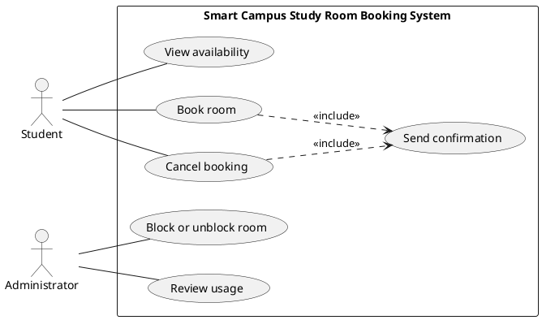

# Lab report — Practice #03, Requirements Engineering with AI

Fill in every section. **Do not delete or renumber the headings** — the README points at them and a
missing heading reads as a missing section.

Name: Darkhan Izbassarov
Student ID: 24B031815
GitHub username: Darics3

---

## 1. Setup

| | |
| --- | --- |
| AI assistant (tool) | ChatGPT |
| Exact model name and version | GPT-5.6 Sol |
| Date of the session | 22.09.2026 |
| Diagram renderer used | PlantUML |

One tool and one model for all three prompts. If you switched, say why here — it changes what your
findings mean.

---

## 2. Original AI output — user stories (Part 1)

Paste the **unedited** response to Prompt 1. Do not tidy it. If it is long, paste all of it anyway;
this is the baseline everything else is measured against.

```
## Student and Administrator Goals

**Student goals:**
The Student wants to see when study rooms are available, reserve an available room, cancel a reservation they previously made, and receive confirmation when a booking or cancellation succeeds.

**Administrator goals:**
The Administrator wants to control whether rooms are available for booking by blocking or unblocking them and review room usage over a selected period.

## User Stories

| ID        | User Story                                                                                                                                                         | Priority | Assumption                                                                                                                                                             |
| --------- | ------------------------------------------------------------------------------------------------------------------------------------------------------------------ | -------- | ---------------------------------------------------------------------------------------------------------------------------------------------------------------------- |
| **US-01** | As a **Student**, I want to **view room availability**, so that I can see which rooms are free and when.                                                           | Must     | Availability reflects existing bookings and whether a room is blocked.                                                                                                 |
| **US-02** | As a **Student**, I want to **book a free room for a time slot**, so that I can reserve it for individual or group study.                                          | Must     | The booking must follow R1–R4: it starts in the future, lasts no more than two hours, does not overlap another booking for the same room, and the room is not blocked. |
| **US-03** | As a **Student**, I want to **cancel a booking I made**, so that the reserved room and time slot become available again.                                           | Must     | A Student can cancel only a reservation that they made.                                                                                                                |
| **US-04** | As an **Administrator**, I want to **block or unblock a room**, so that rooms that should not be booked can be taken out of service and later returned to service. | Must     | A blocked room cannot be booked, according to R4.                                                                                                                      |
| **US-05** | As an **Administrator**, I want to **review room usage over a period**, so that I can see how study rooms are being used.                                          | Must     | Usage information is based only on room booking information available within this system.                                                                              |
| **US-06** | As a **Student**, I want to **receive confirmation after a booking or cancellation**, so that I know the requested action was completed.                           | Must     | Confirmation is limited to booking and cancellation confirmation and does not include SMS, push notifications, or reminders.                                           |

## Scope Check

These six stories correspond directly to the six supplied use cases:

**US-01 → UC-01 View availability**
**US-02 → UC-02 Book room**
**US-03 → UC-03 Cancel booking**
**US-04 → UC-04 Block or unblock room**
**US-05 → UC-05 Review usage**
**US-06 → UC-06 Send confirmation**

No stories introduce payments, fines, check-in, QR codes, maintenance requests, authentication, waiting lists, reminder notifications, or implementation details such as screens, databases, or servers.

```

---

## 3. Story review (Part 2)

| Story (as generated) | What I did | Why | Final ID |
| --- | --- | --- | --- |
| US-01 | Kept the story and assumption, changed priority from `Must` to `High`. | The story uses the correct Student actor, maps directly to UC-01, is testable and stays in scope. The final template requires High/Medium/Low priorities. | US-01 |
| US-02 | Kept the story and assumption, changed priority from `Must` to `High`. | It maps directly to UC-02 and correctly references R1–R4. It describes one testable booking outcome. | US-02 |
| US-03 | Kept the story and assumption, changed priority from `Must` to `High`. | It correctly limits cancellation to a booking made by the Student and maps directly to UC-03. | US-03 |
| US-04 | Kept the story and assumption, changed priority from `Must` to `High`. | Administrator is the correct actor for blocking or unblocking rooms, and the story stays within UC-04 and R4. | US-04 |
| US-05 | Kept the story and assumption, changed priority from `Must` to `Medium`. | It correctly gives Review usage to the Administrator and maps to UC-05. It is useful but less central to the booking flow than booking and availability. | US-05 |
| US-06 | Kept the story, changed priority from `Must` to `High`, and rewrote the assumption. | The generated assumption explicitly mentioned SMS, push notifications and reminders, which are on the out-of-scope list. I removed that vocabulary while preserving UC-06. | US-06 |


**Did the assistant invent anything outside the scenario?**

US-06 mentioned SMS, push notifications and reminders in its assumption. These terms are explicitly out of scope, even though the generated story mentioned them only to exclude them. I removed this vocabulary from the final US-06 assumption. I also checked all stories for payments, fines, check-in or QR codes, maintenance requests, authentication, waiting lists, screens, databases and servers.

**How many stories did you end with, and why that number?**

I ended with 6 stories because each story maps directly to one of the six fixed use cases, UC-01 through UC-06. Adding more stories was unnecessary and could widen the fixed scenario.

---

## 4. Original AI output — acceptance criteria (Part 3)

```
## US-02 — Book Room

**User Story:**
As a Student, I want to book a free room for a time slot, so that I can reserve it for individual or group study.

**Assumptions:**

* The selected room and time slot are available when the booking request is submitted.
* A booking is created only if it satisfies rules R1–R4.
* A booking must start in the future.
* A booking may last no longer than two hours.
* Two bookings for the same room cannot overlap.
* A blocked room cannot be booked.

### Acceptance Criteria

**AC-02-1 — Successful booking**
**Given** a room is not blocked and the selected time slot is free
**And** the booking starts in the future
**And** the duration is two hours or less
**When** the Student submits the booking
**Then** the system creates the booking for that room and time slot.

**AC-02-2 — Past or current time**
**Given** the Student selects a booking start time that is not in the future
**When** the Student submits the booking
**Then** the system rejects the booking and indicates that the booking must start in the future.

**AC-02-3 — Duration longer than two hours**
**Given** the Student selects a time slot longer than two hours
**When** the Student submits the booking
**Then** the system rejects the booking and indicates that the maximum booking duration is two hours.

**AC-02-4 — Overlapping booking**
**Given** another booking already exists for the same room during all or part of the selected time slot
**When** the Student submits the booking
**Then** the system rejects the booking and indicates that the room is not available for that time slot.

**AC-02-5 — Blocked room**
**Given** the selected room is blocked by an Administrator
**When** the Student attempts to book the room
**Then** the system rejects the booking and indicates that the room is unavailable.

## US-04 — Block or Unblock Room

**User Story:**
As an Administrator, I want to block or unblock a room, so that rooms can be taken out of service and later returned to use.

**Assumptions:**

* Only the Administrator performs the block or unblock action.
* A blocked room cannot accept new bookings according to R4.
* Unblocking a room makes it available for future bookings, subject to R1–R3.
* The handling of bookings created before a room is blocked is outside the defined requirements.

### Acceptance Criteria

**AC-04-1 — Successfully block a room**
**Given** a room is currently unblocked
**When** the Administrator blocks the room
**Then** the system marks the room as blocked and prevents new bookings for that room.

**AC-04-2 — Blocked room cannot be booked**
**Given** a room has been blocked by the Administrator
**When** a Student attempts to create a booking for that room
**Then** the system rejects the booking and indicates that the room is unavailable.

**AC-04-3 — Successfully unblock a room**
**Given** a room is currently blocked
**When** the Administrator unblocks the room
**Then** the system marks the room as unblocked and allows valid future bookings subject to R1–R3.

**AC-04-4 — Block an already blocked room**
**Given** a room is already blocked
**When** the Administrator attempts to block it again
**Then** the room remains blocked and the system indicates that it is already blocked.

**AC-04-5 — Unblock an already unblocked room**
**Given** a room is already unblocked
**When** the Administrator attempts to unblock it again
**Then** the room remains unblocked and the system indicates that it is already available.

## US-06 — Send Confirmation

**User Story:**
As a Student, I want to receive confirmation after a booking or cancellation, so that I know the requested action was completed.

**Assumptions:**

* Confirmation is produced only after a booking or cancellation has been successfully completed.
* A booking must satisfy R1–R4 before a booking confirmation can be produced.
* An unsuccessful booking or cancellation does not produce a success confirmation.

### Acceptance Criteria

**AC-06-1 — Confirmation after successful booking**
**Given** the Student submits a booking that starts in the future, lasts no more than two hours, does not overlap another booking, and is for an unblocked room
**When** the booking is successfully created
**Then** the system sends a confirmation that the booking was completed.

**AC-06-2 — Confirmation after successful cancellation**
**Given** the Student has an existing booking
**When** the Student successfully cancels that booking
**Then** the system sends a confirmation that the cancellation was completed.

**AC-06-3 — No confirmation for invalid booking**
**Given** a booking violates at least one of R1–R4
**When** the Student submits the booking
**Then** the system rejects the booking and does not send a booking confirmation.

**AC-06-4 — No confirmation for unsuccessful cancellation**
**Given** the requested cancellation cannot be completed
**When** the Student submits the cancellation request
**Then** the system does not send a cancellation confirmation and indicates that the cancellation was unsuccessful.

```

---

## 5. Criteria review (Part 3)

| Criterion (as generated) | Problem | What I changed it to | Final ID |
| --- | --- | --- | --- |
| AC-02-1 | ID does not follow the required global AC-nn scheme. Otherwise the successful-booking behavior is valid. | Kept the behavior and renumbered it. | AC-01 |
| AC-02-2 | Correct invalid case, but the ID format is wrong. | Kept the past/current-time rejection and renumbered it. | AC-02 |
| AC-02-3 | Correct validation case, but it does not explicitly settle whether exactly two hours is valid. | Kept rejection for more than two hours and explicitly declared that exactly two hours is allowed. | AC-03 |
| AC-02-4 | Correct overlap case, but it does not define whether touching bookings overlap. | Kept it and explicitly declared that a booking starting when another ends is allowed. | AC-04 |
| AC-02-5 | Correct R4 invalid case; ID format is wrong. | Kept the blocked-room rejection and renumbered it. | AC-05 |
| AC-04-1 | Valid behavior but ID format is wrong. | Kept and renumbered. | AC-06 |
| AC-04-2 | This repeats the blocked-room booking validation already covered by US-02, but it is useful for verifying the effect of blocking. | Kept a shorter version as the alternative case for US-04. | AC-08 |
| AC-04-3 | Valid unblock behavior but ID format is wrong. | Kept and renumbered. | AC-07 |
| AC-04-4 | The scenario never specifies what message or behavior is required when blocking an already blocked room. | Removed it rather than inventing behavior. | — |
| AC-04-5 | The scenario never specifies what should happen when unblocking an already unblocked room. | Removed it rather than inventing behavior. | — |
| AC-06-1 | Valid confirmation behavior, but ID format is wrong. | Kept and renumbered. | AC-09 |
| AC-06-2 | Valid cancellation-confirmation behavior, but ID format is wrong. | Kept and renumbered. | AC-10 |
| AC-06-3 | Good negative case. | Kept and renumbered. | AC-11 |
| AC-06-4 | “Cancellation cannot be completed” is too vague to become a precise test because the scenario does not define the failure condition. | Removed it rather than inventing a cancellation rule. | — |


**The two open questions.** Write your decision and the reason. Either answer is accepted.

| Question | My decision | Why |
| --- | --- | --- |
| A booking ending exactly when another begins — overlap under R3? | allowed | The bookings touch at the boundary but do not occupy the room at the same time. |
| Is exactly two hours allowed under R2? | allowed | R2 says a booking lasts at most two hours, so exactly two hours is within the allowed maximum. |

**Which invalid or boundary case did the assistant leave out?**

The assistant did not explicitly cover the two boundary cases required by the scenario: a booking that starts exactly when another booking ends, and a booking lasting exactly two hours. I resolved both in the final assumptions: touching bookings are allowed, and exactly two hours is allowed.

---

## 6. Original AI output — use-case diagram (Part 4)

```
## 6. Original AI output — use-case diagram (Part 4)



Rendered diagram: `requirements/use-cases.jpg`

---

## 7. Diagram review (Part 4)


Потом **Section 7 — Diagram review** заполни так:

```markdown
## 7. Diagram review (Part 4)

| Element | Problem | What I changed |
| --- | --- | --- |
| Student → View availability | No problem. Student triggers this function. | Kept unchanged. |
| Student → Book room | No problem. Student triggers this function. | Kept unchanged. |
| Student → Cancel booking | No problem. Student triggers this function. | Kept unchanged. |
| Administrator → Block or unblock room | No problem. This is an Administrator responsibility. | Kept unchanged. |
| Administrator → Review usage | No problem. The Administrator reviews room usage. | Kept unchanged. |
| Send confirmation | The AI correctly did not connect a person directly to this use case because confirmation is produced by the system. | Kept without a direct actor association. |
| Book room → Send confirmation | The `<<include>>` relationship is justified because a completed booking is confirmed by the system. | Kept unchanged. |
| Cancel booking → Send confirmation | The `<<include>>` relationship is justified because a completed cancellation is confirmed by the system. | Kept unchanged. |

**Associations. Which actor–use-case links did the assistant draw that a person does not actually trigger? Name them.**

None. The generated diagram did not connect any actor to a use case that the actor does not trigger. In particular, it correctly connected `Review usage` only to Administrator and did not directly connect Student or Administrator to `Send confirmation`.

**Did any screen, database or internal component appear as a use case or an actor?**

No. The diagram contains only the two required actors and the six fixed business use cases.

---

## 8. Traceability (Part 5)

Summarise what the table in `requirements/traceability.md` shows:

- Use cases with **no story** behind them: none
- Stories with **no use case** they belong to: none
- Criteria that test **no rule** from section 1: AC-10 tests the confirmation of a successful cancellation rather than one of business rules R1–R4.

**What does the largest gap tell you about the generated requirements?**

The largest gap is that UC-01, UC-03 and UC-05 have user stories but no dedicated acceptance criteria. This happened because the task required acceptance criteria for only three selected stories. The traceability table makes this limitation visible instead of hiding it or inventing additional criteria.

---

## 9. Checker runs

Paste the **real terminal output** of both runs. A table with nothing behind it does not count.

```
$ python tests/check_requirements.py
(paste)
```

```
$ python tests/validate_submission.py
(paste)
```

| | PASS | FAIL | ERROR |
| --- | --- | --- | --- |
| `check_requirements.py` | | | |

Commit these numbers were produced at (`git rev-parse --short HEAD`):

**Every FAIL, one line each: what it is and what you decided to do about it.** A FAIL you report and
explain costs you nothing.

**Did you run the checks by hand instead of with Python?** Say so here — it costs nothing, but it
has to be said.

---

## 10. Conclusion (150–200 words)

Answer all three:

1. Which part of the generated requirements was most wrong, and how would you have caught it without
   a checker?
2. What did the assistant get right that would have taken you noticeably longer by hand?
3. You are handing these requirements to someone who will implement them, and you will not be in the
   room. Which single one would you rewrite first, and why?

Be specific. "The AI was useful" is worth nothing; "UC-06 had no story behind it until I wrote
US-07, and the checker is what told me" is worth everything.
